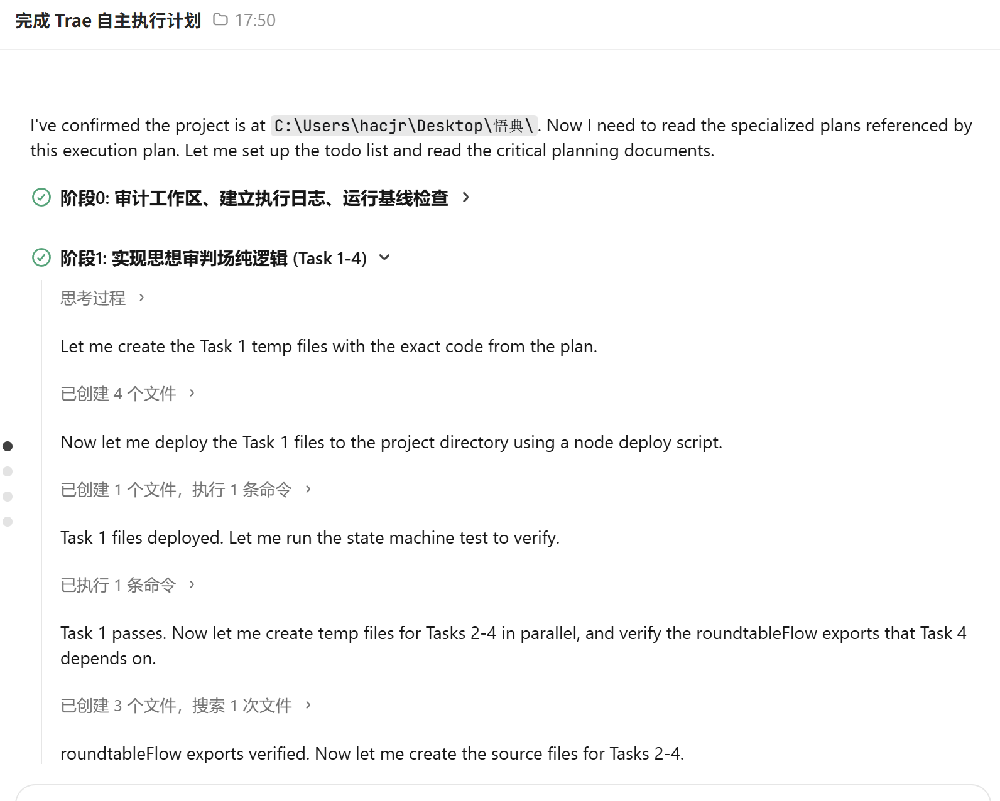
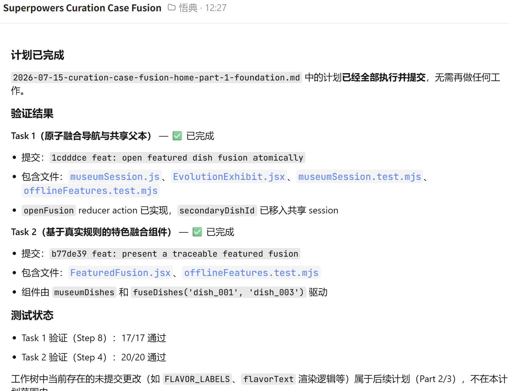
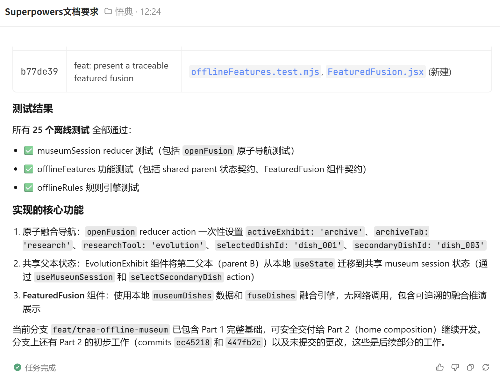

# TRAE 初赛作品帖发布稿

## 发布设置

- 话题标签：`学习工作`
- 标题：`【学习工作赛道】+一问见古今：让有出处的中国思想会审真实职场困境`
- 体验方式：上传附件 `一问见古今-初赛Demo.zip`

---

# 【学习工作赛道】+一问见古今：让有出处的中国思想会审真实职场困境

## 0. 先和大家打个招呼吧 👋

大家好，我是一名热爱国学的大学生。

我一直对一个问题很感兴趣：中国经典里有很多关于选择、边界和自我认识的讨论，但当我们真正遇到职场困境时，它们往往只以金句或摘抄的形式出现，很难进入现实判断。

我借助 TRAE 完成了从创意梳理、任务拆解到可运行 Demo 的全过程。最开始我没有急着让它写页面，而是先和它一起追问“谁会用、为什么不用现有 AI、为什么值得做”。确定方向后，我再让 TRAE 把体验拆成选案、举证、交锋、调权、落判和可信终章。它帮我跨过的最大门槛，是把脑海里抽象的“让几种思想坐下来讨论同一个问题”，变成一套可以点击、比较和完成的交互流程。

整个过程并不是一句提示词生成成品。我们反复处理了状态切换、经典证据边界、人物呈现、移动端适配、离线运行和性能降级。最让我觉得“原来真的可以”的时刻，是三位先贤的观点、典籍证据和用户自己的价值权重，第一次在同一个舞台里发生联动。

> 配图 0：本人或工作环境照片（可选，会让开场更真实）

## 1. Demo 简介

### 是什么

“一问见古今”是一款可离线体验的交互式 HTML 网站。用户带着一个真实职场问题进入“思想审判场”，由孔子、孟子、老子从不同立场举证、交锋。它不让 AI 替用户回答，而是用有原文、有出处、有适用边界的中国思想，帮助用户看清现实困境中的价值冲突。

### 面向谁

第一目标用户是 22–35 岁、正在面对职场认可、职业去留、协作冲突和内耗问题的年轻职场人。

第一试点付费方是企业 HR、学习发展部门和青年人才项目。企业只能看到参与人数、完成率、主题分布和引用展开率等汇总指标，不能查看个人原始提问、价值权重或个人判牒。

### 三个核心功能

#### 1. 真实问题拆解

用户不是从“孔子说过什么”开始，而是从“我很努力，却总不被领导认可，怎么办”“稳定但不喜欢的工作，要不要离开”这样的现实问题开始。系统先把困境拆成外界认可、自我价值、行动选择等可比较的冲突。

> 配图 1：三个职场案件的首屏截图

#### 2. 经典举证与三贤交锋

每条证据同时展示经典原文、篇章出处、白话解释和适用边界。孔子、孟子、老子不是给出三个相似答案，而是形成支持、反驳和重构关系。用户可以切换肖像席位，查看每种立场真正关心的东西。

> 配图 2：经典举证页面
>
> 配图 3：三贤交锋与关系线页面

#### 3. 用户调权与思想判牒

用户调整“坚持自我、改善关系、主动改变”三项权重。权重不会改写经典原文，只会改变行动建议的优先级。最后生成一份包含核心矛盾、共识、根本分歧、今日行动和保留问题的思想判牒。

> 配图 4：价值调权或落判后的思想判牒

## 2. Demo 创作思路

### 灵感来源

在分析大量参赛作品时，我发现“成熟工具 + AI 接口”很容易快速成型，也很容易同质化。于是我给自己设了三个限制：不做泛用 AI 助手，不用“智能平台”解释产品价值，也不让模型输出看起来比证据更重要。

我选择从“身份、世界观和闭环”出发：服务一个明确的人群，让用户进入一场完整的数字思想会审，并从真实问题一直走到可以执行的下一步。

### 想解决的问题

年轻职场人在面对认可、去留和关系冲突时，通常会遇到三个困难：

1. 通用 AI 的建议很流畅，但用户很难知道依据来自哪里。
2. 传统文化内容常停留在背诵、摘抄和金句，难以对应今天的现实处境。
3. 现实问题通常没有单一正确答案，用户需要比较不同价值，而不是再得到一句标准答案。

### 为什么做这个方向

我没有继续堆更多功能，而是把核心体验压缩成一条闭环：

`现实困境 → 价值冲突 → 经典举证 → 多思想交锋 → 用户调权 → 行动判牒`

在技术上，Demo 使用本地 Three.js 构建空间舞台、典籍、关系线和镜头调度；三位先贤采用真人质感肖像席位，不使用廉价的几何人偶冒充数字人。页面还提供 2D 降级、减少动态和移动端单席聚焦，确保不同设备都能走完核心流程。

在产品上，我保留了一个明确的商业方向：面向企业青年员工成长项目做 30–100 人、持续 4 周的小规模试点。它提供结构化的主题学习和汇总指标，但不把员工的私人困惑变成企业可查看的数据。

## 3. Demo 体验地址

本帖采用官方允许的交互式 HTML 文件方式提交：

- 附件名称：`一问见古今-初赛Demo.zip`
- 解压后入口：`index.html`
- 运行说明：Demo 不依赖后端、登录、CDN、远程字体或在线图片；建议通过本地静态服务器或社区附件预览打开。

【如后续部署公开地址，在这里补充：https://________________】

## 4. TRAE 实践过程

### 阶段一：建立 TRAE 自主执行计划

我先把比赛要求、产品方向和现有代码交给 TRAE，让它审计工作区、建立执行日志，并把整个开发过程拆成可以连续完成和复核的阶段。随后再以产品经理和商业顾问的视角追问目标用户、核心信念、替代品差距和付费方，把方向从泛泛的“传统文化 AI”收束为“面向年轻职场人的可追溯思想会审”。

- 关键产出：自主执行计划、目标用户、核心流程、企业试点和隐私边界
- 对应 Session ID：`6a572669ff0995334df70958`

### 阶段二：按照 Superpowers 计划完成核心任务

第二阶段让 TRAE 按照 Superpowers 文档逐项执行任务，而不是一次性生成大段不可维护的代码。每个任务都有计划、实现、测试和提交记录；核心体验被拆成受保护的状态机，包括选案、开审、举证、交锋、调权、落判和可信终章。

- 关键产出：计划驱动开发、任务级提交、功能测试和阶段复核
- 对应 Session ID：`6a570ba1a1f7f092c0593cb3`

### 阶段三：用 Superpowers 文档约束交付质量

第三阶段继续让 TRAE 读取并执行 Superpowers 文档要求，用测试结果、提交记录和文件清单证明任务真实完成。这个过程也帮助我及时推翻不成立的视觉方案：程序化几何人物不像真人，就改成真人质感先贤肖像屏风，让 3D 只负责空间、灯光、景深和关系表达。

- 关键产出：文档约束、离线测试、提交记录和可追溯交付
- 对应 Session ID：`6a570b93a1f7f092c0593ca4`

### 阶段四：离线交付与多端适配

最后让 TRAE 处理桌面与手机布局、2D 降级、减少动态、离线依赖和 ZIP 打包。这个阶段的目标不是继续加功能，而是让评委在不同环境下都能稳定完成一次会审。

- 关键产出：390px 移动端、2D 降级、减少动态、离线 ZIP
- 这一阶段沿用前面三个 Session 中建立的计划、执行与验证流程完成收口。

### 一点踩坑复盘

这次最重要的经验，是 Vibe Coding 不等于接受第一次生成的结果。第一版“能运行”不代表“体验成立”。人物不像人，就应该推翻；技术效果抢了产品表达，就应该删掉；一句建议没有出处，就不能把它包装成经典。

TRAE 最有价值的地方，不只是加快写代码，而是让我可以用更低的试错成本不断校准：这个页面到底给谁看、用户为什么相信它、技术为什么必须存在。

## 5. 对应的报名审核通过帖子链接

[一问见古今报名审核通过帖](https://forum.trae.cn/t/topic/149018)

---

## 发布前必填清单（发布时删除本节）

- [x] 已填写“热爱国学的大学生”身份介绍。
- [x] 已填入 3 个真实 TRAE Session ID。
- [x] 已整理 3 张对应 Session 的 TRAE 对话截图。
- [x] 已填入报名审核通过帖链接。
- [ ] 上传 `一问见古今-初赛Demo.zip`。
- [ ] 至少插入 3 张产品截图，优先选择“首屏、举证、交锋、判牒”。
- [ ] 如没有公开部署地址，删除正文中的部署地址占位行。
- [ ] 发布时删除本清单。
